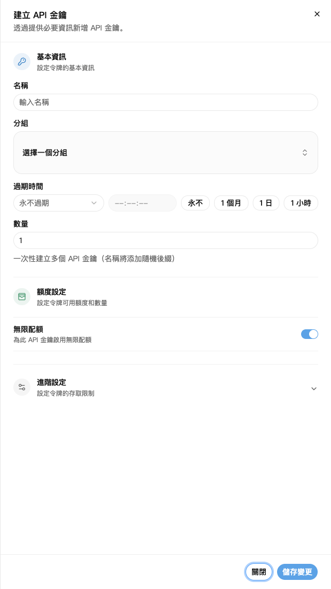
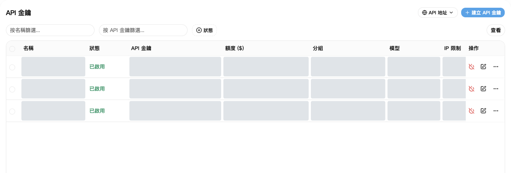
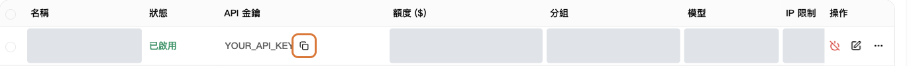

API 金鑰就是軟體連接 NexusAPI 時要填的 Key。

需要只允許指定電腦或伺服器使用 Key？請按 [IP 白名單設定教學](/zh-TW/guide/ip-whitelist)填寫。

## 1. 建立金鑰

1. 開啟 [API 金鑰](https://nexusapi.link/keys)。
2. 點右上角「建立 API 金鑰」。
3. 按下表填寫。
4. 點「儲存變更」。

| 項目 | 怎麼填 |
| --- | --- |
| 名稱 | 自己能辨識即可，例如 `我的電腦` |
| 分組 | 選客服提供的分組；不知道選哪個，先問客服 |
| 建立數量 | 填 `1` |
| 過期時間 | 第一次使用可保持預設 |
| 配額、進階設定 | 沒有特殊需求，保持預設 |

截圖中的灰色區域是已隱藏的個人資料，不代表功能無法使用。示例分組、模型與價格以實際頁面為準。

「無限配額」不代表免費，呼叫仍會扣除帳戶餘額或方案額度。

進階設定的「允許查詢使用者額度」：開啟後，持有這把 Key 的軟體可查詢你的帳戶剩餘與已用額度。自己使用可保持預設；分享 Key 前，先確認是否允許對方查看這些資訊。

## 2. 複製到軟體

1. 回到金鑰清單，找到剛建立的金鑰。
2. 點複製按鈕，複製完整 Key，不要手動抄含星號的文字。
3. 貼到軟體的「API Key」欄位。
4. 位址和模型名稱，照[對應軟體教學](/zh-TW/tools)填寫。

複製完整 Key：按框出的複製按鈕；圖中的 Key 是佔位符。

需要複製平台位址時，點金鑰頁右上角的「API 地址」。軟體是否要加 `/v1`，仍按[對應軟體教學](/zh-TW/tools)填寫，不要自行拼接路徑。

**用這裡建立的 Key，不要用「安全與存取」裡的存取權杖。**

更多選單的「複製連接資訊」會同時複製位址與完整 Key，**不是可公開分享的一般連結**。只有信任的軟體明確支援該格式時才使用；一般設定按上述步驟單獨複製 Key。不要將連接資訊傳到群組或提供客服。

## 3. 金鑰外洩怎麼辦

立即在清單停用或刪除舊 Key，重新建立，再替換軟體裡的 Key。

不要把完整 Key 放到群組聊天、截圖或公開程式碼。客服也不需要你的完整 Key。

## 更換分組或 Key

**改分組不必重新建立 Key：**

1. 在 [API 金鑰](https://nexusapi.link/keys)找到正在使用的 Key，點該列「編輯」。
2. 選已開放、適用於目標軟體的分組並儲存。找不到目標分組先聯絡客服，不要隨便選。
3. 到[模型廣場](https://nexusapi.link/pricing)選新分組，確認模型與價格，再按[換模型步驟](/zh-TW/billing/models-pricing#change-model)修改並測試。

編輯分組不會產生新 Key，但會影響共用這把 Key 的所有程式。只想改一個程式時，為它單獨建立 Key 更容易管理。

**換 Key：** 正常更換時，先建立新 Key、替換軟體設定，重啟並確認呼叫成功後，再停用不用的舊 Key。Key 已外洩則立即停用，不要等測試。不要把新舊 Key 傳給客服。

若分組顯示「跟隨使用者」「繼承」「跨分組」或 `auto`，先向客服確認實際可用分組、模型與費用，不要按固定倍率猜價格，也不要只為符合範例而改組。

## 設定額度、有效期與模型限制

1. 在 [API 金鑰](https://nexusapi.link/keys)找到目標 Key，點「編輯」。
2. 依下表修改需要限制的項目，其他不動。
3. 點「儲存變更」。共用這把 Key 的所有軟體都會受影響。

| 想限制什麼 | 怎麼設定 |
| --- | --- |
| Key 還能用多少 | 在「額度設定」關閉「無限配額」，按欄位顯示單位填額度 |
| 用到什麼時候 | 在「過期時間」選日期與時間；不設期限則點「永不」 |
| 允許哪些模型 | 展開「進階設定」，在「模型限制」選允許的模型 |
| 允許哪些來源 IP | 按 [IP 白名單教學](/zh-TW/guide/ip-whitelist)填寫 |

**額度填的是剩餘可用量，不是儲值金額，也不是追加量。** 若單位是 `$`，填 `10` 表示 Key 剩餘 `$10` 帳戶額度，不是人民幣 10 元，也不是在原額度上加 10。以實際欄位單位為準。

這不是每月自動重置的預算。帳號仍須有餘額或適用方案；「無限配額」只取消該 Key 自身的額度限制。

取消「模型限制」的全部選項，表示不額外限制這把 Key，**不會解鎖分組沒有的模型**。更換模型或分組請按上方步驟。

建議不同軟體使用不同名稱的 Key，例如 `辦公電腦`、`伺服器應用`，方便分別查消耗與停用。臨時分享不要同時設定無限額度與永不過期。

Claude Code 需要輔助模型時，允許清單也要包含已確認可用的輔助模型；只選主模型可能使部分操作失敗。名稱按[軟體教學](/zh-TW/tools/claude-code)或客服確認結果填寫。

## 暫停、恢復或刪除 Key

- **暫時不用**：點該列提示為「停用」的電源按鈕，確認該列狀態變為「已停用」。後續使用這把 Key 的請求會被拒絕。
- **恢復使用**：在同處點「啟用」。若提示過期或額度耗盡，先編輯期限或剩餘額度、儲存再啟用；反覆點啟用無法解除限制。
- **不再使用**：在該列更多選單選「刪除」，先確認沒有軟體依賴它，再依提示操作。不要用刪除代替暫停。

關閉瀏覽器或登出不會停用 Key。消耗異常時先停用相關 Key，再按[日誌教學](/zh-TW/billing/usage-and-billing#find-key-usage)核對。

### Key 無法使用，先查這 4 項

| 檢查什麼 | 怎麼處理 |
| --- | --- |
| 已停用、已過期 | 找到軟體正在使用的 Key，檢查狀態與有效期 |
| 可用額度 | 同時檢查錢包餘額與 Key 剩餘額度；無限配額不代表帳號有餘額 |
| 模型權限 | 核對分組可用模型與 Key 模型限制；Claude Code 也要檢查輔助模型 |
| 來源 IP | 錯誤明確提到 IP 不允許時，按 [IP 白名單教學](/zh-TW/guide/ip-whitelist)核對出口，不要開放全部 IP |

仍無法使用時，保留錯誤原文並按[錯誤自查](/zh-TW/faq/self-check)處理。不要連續重試，也不要將完整 Key 提供客服。
