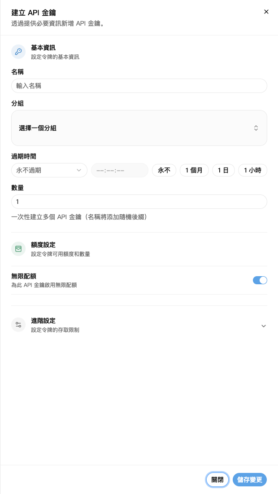
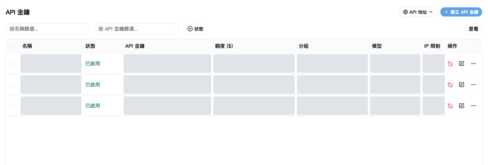
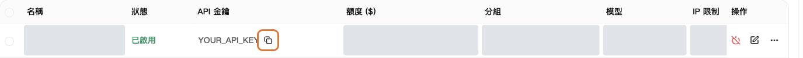

API 金鑰就是軟體連接 NexusAPI 時要填的 Key。

## 1. 建立金鑰

1. 開啟 [API 金鑰](https://nexusapi.link/keys)。
2. 點右上角「建立 API 金鑰」。
3. 按下表填寫。
4. 點「儲存變更」。

| 項目 | 怎麼填 |
| --- | --- |
| 名稱 | 自己能辨識即可，例如 `我的電腦` |
| 分組 | 選客服提供的分組；不知道選哪個，先問客服 |
| 建立數量 | 填 `1` |
| 過期時間 | 第一次使用可保持預設 |
| 配額、進階設定 | 沒有特殊需求，保持預設 |

截圖中的灰色區域是已隱藏的個人資料，不代表功能無法使用。示例分組、模型與價格以實際頁面為準。

「無限配額」不代表免費，呼叫仍會扣除帳戶餘額或方案額度。

進階設定的「允許查詢使用者額度」：開啟後，持有這把 Key 的軟體可查詢你的帳戶剩餘與已用額度。自己使用可保持預設；分享 Key 前，先確認是否允許對方查看這些資訊。

## 2. 複製到軟體

1. 回到金鑰清單，找到剛建立的金鑰。
2. 點複製按鈕，複製完整 Key，不要手動抄含星號的文字。
3. 貼到軟體的「API Key」欄位。
4. 位址和模型名稱，照[對應軟體教學](/zh-TW/tools)填寫。

複製完整 Key：按框出的複製按鈕；圖中的 Key 是佔位符。

需要複製平台位址時，點金鑰頁右上角的「API 地址」。軟體是否要加 `/v1`，仍按[對應軟體教學](/zh-TW/tools)填寫，不要自行拼接路徑。

**用這裡建立的 Key，不要用「安全與存取」裡的存取權杖。**

## 3. 金鑰外洩怎麼辦

立即在清單停用或刪除舊 Key，重新建立，再替換軟體裡的 Key。

不要把完整 Key 放到群組聊天、截圖或公開程式碼。客服也不需要你的完整 Key。

## 更換分組或 Key

**改分組不必重新建立 Key：**

1. 在 [API 金鑰](https://nexusapi.link/keys)找到正在使用的 Key，點該列「編輯」。
2. 選已開放、適用於目標軟體的分組並儲存。找不到目標分組先聯絡客服，不要隨便選。
3. 到[模型廣場](https://nexusapi.link/pricing)選新分組，確認模型與價格，再按[換模型步驟](/zh-TW/billing/models-pricing#change-model)修改並測試。

編輯分組不會產生新 Key，但會影響共用這把 Key 的所有程式。只想改一個程式時，為它單獨建立 Key 更容易管理。

**換 Key：**正常更換時，先建立新 Key、替換軟體設定，重啟並確認呼叫成功後，再停用不用的舊 Key。Key 已外洩則立即停用，不要等測試。不要把新舊 Key 傳給客服。
