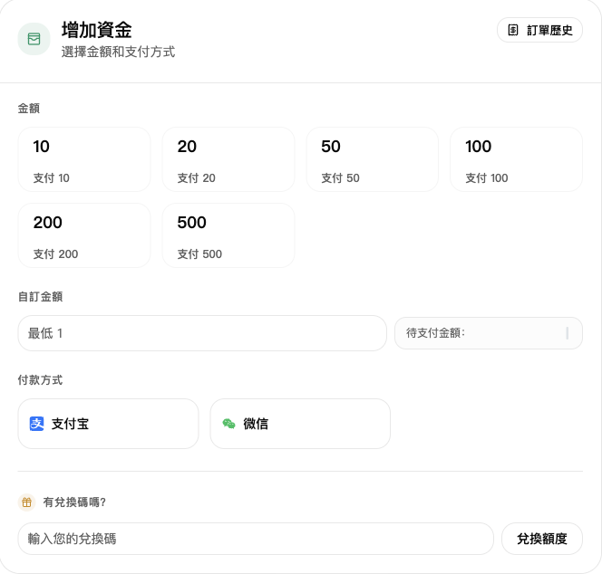

## 1. 儲值

1. 開啟[錢包](https://nexusapi.link/wallet)。
2. 在「增加資金」選金額，或輸入自訂金額。
3. 看清應付金額和入帳額度，再選付款方式。
4. 按付款頁面提示完成付款。
5. 回到錢包重新整理，確認餘額增加。

錢包裡的 `$` 是可用額度，不是人民幣付款金額。不清楚時，見[倍率與折扣](/zh-TW/billing/multipliers-and-discounts)。

## 2. 有兌換碼或想買方案

- **兌換碼**：在錢包「有兌換碼嗎？」貼上兌換碼，點「兌換額度」。
- **訂閱方案**：如果錢包顯示方案，購買前看清使用期限、包含額度和可用分組；方案和儲值餘額不同。不確定適不適合，先問客服再買。

## 3. 已付款，但沒有入帳

先重新整理錢包，再點「訂單歷史」看訂單狀態。仍未入帳，把下面資料傳給客服：

- 登入帳號。
- 付款時間、金額和付款方式。
- 訂單號、付款截圖。

截圖請遮住敏感資訊。**不要提供密碼、驗證碼或完整 API Key。**

## 查看歷史付款訂單

1. 開啟[錢包](https://nexusapi.link/wallet)，點「訂單歷史」。
2. 有訂單號時，在「按訂單號搜尋...」輸入編號；沒有時翻頁比對付款時間與金額，找到紀錄後查看狀態。搜尋框不是時間或金額篩選框。
3. 同時回錢包重新整理餘額確認入帳；付款截圖不能代替入帳確認。

| 訂單狀態 | 接下來怎麼做 |
| --- | --- |
| 成功 | 回錢包重新整理並核對餘額；有疑問提供訂單號給客服 |
| 待確認 | 尚未確認完成；若已扣款，保存憑證找客服核對，不要重複付款 |
| 已過期 | 若已付款但未入帳，找客服核對；不代表款項已退回 |

找不到或狀態不明時，把付款時間、訂單號與遮蓋隱私的付款截圖提供客服，不要直接重複付款。模型呼叫明細在[使用日誌](/zh-TW/billing/usage-and-billing)，不是付款訂單。
